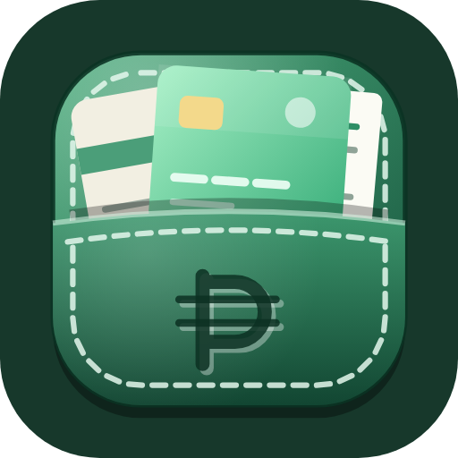

  

<h1 align="center">PocketBudget</h1>

  A personal weekly allowance and expense tracker for Android. 
  Private, offline-first, and made to feel like a real finance app.

  <a href="https://github.com/zennQrain/PocketBudget-releases/releases/latest"><b>⬇ Download the latest version</b></a>

---

## What it does

- **Weekly allowance:** set your allowance and see what you've spent and what's left, at a glance.
- **Category budgets:** Food, Transport, School, Savings and Personal, scaled to your allowance.
- **Expenses:** add, edit and delete purchases with a date, category and note.
- **History:** every expense grouped by week.
- **Monthly tracker:** month-by-month totals, category and weekly breakdowns.
- **Excel export:** save a monthly report as an `.xlsx` workbook.
- **Your week, your way:** choose whether your week starts on Monday or Sunday.
- **Dark mode and Liquid Glass:** an optional glass look with your own wallpaper.
- **Works offline:** your data stays on your phone.

## Install

1. Tap **Download the latest version** above, then download the file ending in **.apk**.
2. Open the downloaded file. If Android asks, allow your browser or Files app to **install unknown apps**.
3. Tap **Install**, then open PocketBudget.
4. PocketBudget is **invite-only**. Enter the invite code you were given by Paulino.

Requires Android 8.0 or newer.

## Updates

When a new version is released, PocketBudget shows an **Update now / Later** pop-up the next time you open it with internet. Your expenses and settings are kept. You tap **Install** once, and that's it. You can also check manually in **Settings → App updates**.

## Privacy

Your expenses, settings and name are stored **only on your phone**. The app uses the internet only to check this page for updates.

---

© 2026 PocketBudget · Made by Paulino Rain Segarra

